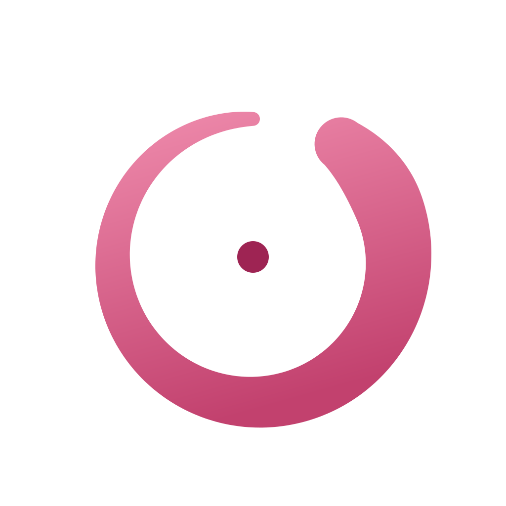

<p align="center"></p>

# Koan

A calm browser for the Mac. Koan is a fork of [Yab](https://github.com/yetanotherbrowser/yab), reshaped around a Zen-style window: the address bar sits on the window itself and the page is a card under it, tabs down the side, nothing in the way.

It renders pages with WebKit, the engine inside every Mac, and can open any site in Chromium (CEF) instead, per site. It can be your Mac's default browser. No account is needed to download, install or use it.

## What Koan adds to Yab

- **A Zen-style address bar** on the window's own backdrop; folded away, it slides down with the page carried under it when the pointer reaches the top.
- **Focus**, a list of sites kept closed, that can be **locked** for a while and turned on, locked or unlocked by other apps: app blockers, scripts, Shortcuts and the Mac's own Focus modes (`open -g "yab-focus://lock?minutes=50"`).
- **Smart Downloads by default**: big downloads go through aria2, many connections at once, with torrents, magnet links and debrid services.
- **Web panels** beside the page, **highlights** that stay on pages, one tab playing sound at a time, downloads sorted into folders, idle tabs put to sleep.

## Download

Signed and notarized builds will be on the [Releases](https://github.com/hczr-dev/koan/releases) page; until the first one is up, build it as below.

## Build it

On a Mac with Xcode 26 or later:

```bash
git clone https://github.com/hczr-dev/koan.git
cd koan && scripts/custom/build-dev.sh
open build/Koan.app
```

`scripts/custom/build-dev.sh` wraps Yab's `./build.sh` with Koan's name, icon and bundle id, Chromium tabs and the Smart Downloads engine. `scripts/custom/sync-upstream.sh` brings in Yab's newest changes.

## License and credit

Koan is built on Yab's source, licensed under the [Apache License 2.0](../LICENSE); its changes to Yab are in this repository's history. Koan is not made, endorsed or supported by Yab or its maintainers. "Yab" and the Yab logo are Yab's trademarks ([TRADEMARKS.md](../TRADEMARKS.md)), used here only to say where Koan comes from.
